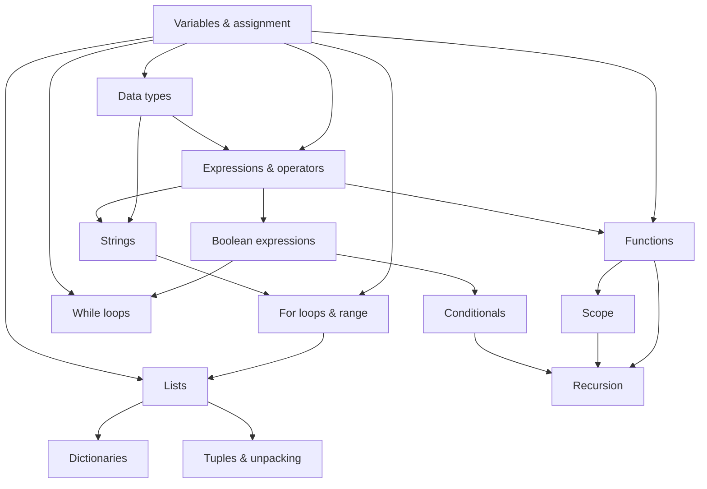

# Adaptive Learning với LLM Agent

Đồ án nghiên cứu xem một **LLM Agent** có đưa ra quyết định sư phạm tốt hơn các chiến lược
adaptive learning truyền thống hay không, khi tất cả cùng nhận **một learner state tường minh
như nhau**.

> **Câu hỏi nghiên cứu chính:** Với cùng learner state và cùng tập action sư phạm, policy dựa
> trên LLM có chọn action tiếp theo tốt hơn chiến lược ngẫu nhiên và chiến lược luật (rule-based)
> hay không?
>
> **Câu hỏi phụ:** Policy đó có giúp learner đạt learning gain cao hơn hoặc thành thạo nhanh hơn
> không?

Domain là **lập trình Python nhập môn** (14 concept). Để có một thí nghiệm có kiểm soát, mọi
thành phần đều được giữ cố định (question bank, student model, domain, action space), chỉ thay
đổi **policy ra quyết định**:

| Policy | Mô tả |
| :--- | :--- |
| Random | Chọn ngẫu nhiên một action hợp lệ (có seed để tái lập) |
| Rule-based | Luật dựa trên ngưỡng mastery và quan hệ tiên quyết (luật R0–R6) |
| LLM Agent | LLM nhận learner state có cấu trúc và chọn một action trong danh sách |

Trong kiến trúc này LLM chỉ là **bộ ra quyết định**: nó không tạo câu hỏi, không chấm đáp án và
không cập nhật mastery. Những việc đó do code Python làm, dựa trên dữ liệu cố định.

---

## Mục lục

1. [Kiến trúc](#1-kiến-trúc)
2. [Dữ liệu](#2-dữ-liệu)
3. [Cấu trúc thư mục](#3-cấu-trúc-thư-mục)
4. [Cài đặt](#4-cài-đặt)
5. [Hướng dẫn chạy](#5-hướng-dẫn-chạy)
6. [Cấu hình](#6-cấu-hình)
7. [Kết quả hiện tại và hạn chế](#7-kết-quả-hiện-tại-và-hạn-chế)
8. [Phân công và tài liệu nhóm](#8-phân-công-và-tài-liệu-nhóm)

---

## 1. Kiến trúc

Mỗi lượt học diễn ra như sau:

```text
LearnerState + DecisionContext
   │
   ├─► build_available_actions()      Sinh danh sách action hợp lệ (giống nhau cho mọi policy)
   │
   ├─► policy.select_action()         Random / Rule-based / LLM chọn MỘT action
   │
   ├─► BasePolicy.validate()          Action không có trong danh sách → bị từ chối, state giữ nguyên
   │
   ├─► ActionExecutor.execute()       ASK: chọn câu từ question bank, lấy câu trả lời, chấm bằng
   │                                  answer key; StudentModel cập nhật mastery
   │
   └─► Engine cập nhật bối cảnh phiên và ghi log (JSONL)
```

**Learner state** gồm mastery của từng concept (0–1), các lỗi gần đây, các action gần đây và
danh sách câu đã làm. **Decision context** do engine theo dõi: concept đang học, các concept
đã mở, action trước đó, kết quả câu hỏi gần nhất.

**Action space** (cố định về loại, tham số phụ thuộc trạng thái phiên):

| Action | Ý nghĩa |
| :--- | :--- |
| `ASK(concept, difficulty)` | Hỏi một câu trắc nghiệm của concept đang học ở độ khó Easy/Medium/Hard |
| `HINT(concept)` | Gợi ý về câu vừa làm |
| `EXPLAIN(concept)` | Giải thích concept đang học |
| `REVIEW_PREREQUISITE(concept)` | Quay lại ôn một concept tiên quyết |
| `ADVANCE(concept)` | Chuyển sang concept mới |

**Student model:** trung bình trượt mũ (EMA) cố định,
`mastery_mới = mastery_cũ + 0.4 × (kết_quả − mastery_cũ)`, với kết quả = 1 nếu đúng, 0 nếu sai.
Learner đạt mức thành thạo khi mastery ≥ 0.85 (4 câu đúng liên tiếp từ 0).

---

## 2. Dữ liệu

| File | Nội dung |
| :--- | :--- |
| `data/question_bank.csv` | 70 câu trắc nghiệm (14 concept × 5 câu: 2 Easy, 2 Medium, 1 Hard), mỗi câu có đáp án, loại lỗi thường gặp, ánh xạ phương án sai → lỗi, giải thích |
| `data/concept_graph.json` | Đồ thị tiên quyết 14 concept, 21 cạnh (DAG) |
| `data/simulated_learners.json` | 6 hồ sơ learner mô phỏng cho thí nghiệm Phase 6 |
| `evaluation/decision_scenarios.json` | 12 learner state mô phỏng để đánh giá quyết định (Phase 5) |

Đồ thị tiên quyết:



Nguồn khảo sát concept (Python Tutorial, CS50P, Py4E) và lý do chọn domain: xem
`project/project_1.md`.

---

## 3. Cấu trúc thư mục

```text
adaptive-learning-llm-agent/
├── src/adaptive_learning/
│   ├── schemas.py              Hợp đồng dữ liệu: LearnerState, Action, PolicyDecision, Question, TurnResult
│   ├── question_bank.py        QuestionBank và ConceptGraph
│   ├── student_model.py        StudentModel (EMA) và chấm đáp án
│   ├── action_executor.py      Thực thi action đã được kiểm tra
│   ├── action_space.py         Sinh danh sách action hợp lệ
│   ├── engine.py               LearningEngine: một lượt / một phiên học, ghi log
│   └── policies/
│       ├── base.py             BasePolicy, DecisionContext
│       ├── random_policy.py
│       ├── rule_based_policy.py
│       ├── llm_policy.py
│       └── llm_clients.py      Client gọi LLM (API kiểu OpenAI Chat Completions)
├── evaluation/
│   ├── run_decision_evaluation.py   Phase 5: đánh giá chất lượng quyết định
│   ├── run_learning_experiment.py   Phase 6: thí nghiệm học với learner mô phỏng
│   ├── simulated_learner.py         Mô hình learner mô phỏng
│   ├── metrics.py                   Agreement, cờ lỗi sư phạm, learning gain
│   ├── decision_rubric.md           Hướng dẫn gán nhãn expert
│   └── decision_scenarios.json
├── scripts/
│   ├── run_demo.py                  Demo một phiên học
│   └── validate_question_bank.py    Kiểm tra question bank và concept graph
├── data/                            Question bank, concept graph, hồ sơ learner
├── configs/experiment_config.json   Cấu hình thí nghiệm
├── tests/                           Unit test và test tích hợp
├── results/                         Kết quả sinh ra khi chạy đánh giá
└── project/                         Đề cương và khảo sát (project_0.md, project_1.md)
```

---

## 4. Cài đặt

Yêu cầu **Python 3.10 trở lên**. Code chỉ dùng thư viện chuẩn của Python, không cần cài thêm
package nào (kể cả để gọi LLM).

```bash
git clone https://github.com/nguyenTraMy-dasick/adaptive-learning-llm-agent.git
cd adaptive-learning-llm-agent
```

Các lệnh bên dưới chạy từ thư mục gốc của repo. Trên Windows dùng `python`; trên macOS/Linux
có thể cần `python3`.

---

## 5. Hướng dẫn chạy

### 5.1. Kiểm tra mọi thứ hoạt động

```bash
python -m unittest discover -s tests
python scripts/validate_question_bank.py --strict
```

Kết quả mong đợi: tất cả test `OK` và validator in `HỢP ĐỒNG DỮ LIỆU ĐẠT CHUẨN (PASSED)`.
Validator kiểm tra cấu trúc CSV, concept và prerequisite khớp với graph, đáp án hợp lệ, 4 phương
án không trùng nhau và đoạn code trong mỗi câu hỏi compile được. Sau khi sửa question bank,
luôn chạy lại lệnh này.

### 5.2. Demo một phiên học

```bash
python scripts/run_demo.py                                       # rule-based, learner mô phỏng "novice"
python scripts/run_demo.py --policy random --learner weak_functions --steps 25
python scripts/run_demo.py --policy rule --interactive           # tự trả lời câu hỏi trong terminal
python scripts/run_demo.py --policy rule --log results/demo.jsonl
```

Mỗi dòng in ra một lượt: action đã chọn, câu hỏi, đúng/sai, mastery mới và luật đã dùng.
Learner mô phỏng có sẵn: `novice`, `knows_basics`, `weak_functions`, `fast_learner`,
`slow_learner`, `near_mastery`.

### 5.3. Phase 5 — đánh giá chất lượng quyết định

Chạy các policy trên cùng bộ learner state mô phỏng và so với nhãn của expert:

```bash
python evaluation/run_decision_evaluation.py
python evaluation/run_decision_evaluation.py --policies random,rule --random-repeats 50
python evaluation/run_decision_evaluation.py --policies random,rule,llm      # cần cấu hình LLM (mục 6.2)
```

Kết quả ghi vào `results/decision_eval.json`: từng quyết định, tỉ lệ hợp lệ, phân bố loại
action và các cờ lỗi sư phạm (chuyển concept quá sớm, câu quá khó/dễ, lặp lại hỗ trợ).

Độ đồng thuận với expert chỉ được tính khi `expert_labels` trong
`evaluation/decision_scenarios.json` đã được điền. Cách gán nhãn (ít nhất 2 người, độc lập)
xem `evaluation/decision_rubric.md`.

### 5.4. Phase 6 — thí nghiệm học với learner mô phỏng

```bash
python evaluation/run_learning_experiment.py
python evaluation/run_learning_experiment.py --policies random,rule --repeats 30
python evaluation/run_learning_experiment.py --learners novice,weak_functions --max-steps 40
python evaluation/run_learning_experiment.py --policies rule,llm --repeats 2 --log-dir results/sessions
```

Mỗi phiên ghép một policy với một hồ sơ learner và một seed. Learner mô phỏng có "kiến thức
thật" mà policy không nhìn thấy; policy chỉ thấy mastery do student model ước lượng. Script in
bảng so sánh và ghi chi tiết vào `results/learning_experiment.json`:

| Chỉ số | Ý nghĩa |
| :--- | :--- |
| `gain` | Điểm post-test − pre-test (điểm kỳ vọng trên toàn bộ 70 câu) |
| `normalized_gain` | (post − pre) / (1 − pre) |
| `n_questions`, `efficiency` | Số câu đã hỏi; gain / số câu |
| `gain_per_turn` | gain / số lượt |
| `goal_reached`, `steps_to_goal` | Mọi concept đạt mastery 0.85 chưa, và sau bao nhiêu lượt |
| `invalid_turns` | Số lượt policy đưa ra action không hợp lệ |

`--log-dir` ghi log JSONL từng phiên (mỗi lượt một dòng: state, danh sách action, quyết định,
kết quả, prompt và output thô của LLM).

### 5.5. Chạy với LLM

1. Copy `.env.example` thành `.env` và điền thông tin (mục 6.2).
2. Thử trên một phiên ngắn trước:

   ```bash
   python scripts/run_demo.py --policy llm --steps 10
   ```

3. Chạy Phase 5, rồi Phase 6 với `--repeats` nhỏ. Ở Phase 6, **mỗi lượt là một lần gọi API**
   (số lượt × số learner × số seed), nên chi phí tăng nhanh.

Khi LLM trả về sai định dạng, policy hỏi lại tối đa `max_retries` lần. Nếu vẫn sai, lượt đó
được ghi là invalid (hoặc dùng rule-based làm dự phòng nếu bật `fallback_to_rule`).

---

## 6. Cấu hình

### 6.1. `configs/experiment_config.json`

| Khóa | Mặc định | Ý nghĩa |
| :--- | :--- | :--- |
| `seed`, `repeats` | 0, 10 | Seed bắt đầu và số seed cho mỗi cặp policy × learner |
| `policies` | `["random", "rule"]` | Policy chạy mặc định (`random`, `rule`, `llm`) |
| `max_steps` | 60 | Ngân sách lượt mỗi phiên |
| `mastery_goal` | 0.85 | Ngưỡng thành thạo |
| `student_model.learning_rate` | 0.4 | Hệ số EMA của student model |
| `rule_config` | 0.40 / 0.75 / 0.85 / 0.60 | Ngưỡng low / high / advance / tiên quyết yếu của rule-based |
| `llm.max_retries` | 2 | Số lần hỏi lại khi LLM trả lời sai định dạng |
| `llm.fallback_to_rule` | false | Dùng rule-based khi LLM vẫn lỗi |

Tham số dòng lệnh (`--policies`, `--repeats`, `--max-steps`) ghi đè giá trị trong file.

### 6.2. `.env` (cấu hình LLM)

```env
LLM_BASE_URL=https://api.openai.com/v1
LLM_API_KEY=...
LLM_MODEL=...
LLM_TEMPERATURE=0
```

Client gọi endpoint `POST {LLM_BASE_URL}/chat/completions` theo định dạng OpenAI Chat
Completions, nên có thể dùng với nhà cung cấp hoặc server local hỗ trợ định dạng này bằng cách
đổi `LLM_BASE_URL` và `LLM_MODEL`. File `.env` đã nằm trong `.gitignore`, **không commit API key**.

---

## 7. Kết quả hiện tại và hạn chế

Thí nghiệm Phase 6 mặc định (6 learner × 10 seed, 60 lượt mỗi phiên):

| Policy | Gain | Normalized gain | Số câu đã hỏi |
| :--- | :---: | :---: | :---: |
| Random | 0.064 ± 0.031 | 0.108 ± 0.041 | 14.8 |
| Rule-based | 0.100 ± 0.050 | 0.168 ± 0.063 | 31.9 |

LLM Agent chưa được chạy với API thật.

Hạn chế cần lưu ý khi diễn giải:

- **Kết quả Phase 6 là trên mô phỏng**, phụ thuộc giả định trong `evaluation/simulated_learner.py`
  (tỉ lệ đoán 0.25, trượt 0.10, tiên quyết yếu làm giảm khả năng làm bài và tốc độ học, hệ số học
  riêng cho từng loại action). Nếu không có thí nghiệm với người học thật, kết luận nên giới hạn
  ở "LLM Agent đưa ra quyết định thích ứng phù hợp hơn" thay vì "LLM Agent giúp học tốt hơn".
- **Phase 5 chưa có nhãn expert**, nên chưa có số liệu độ đồng thuận.
- **Mỗi concept chỉ có 5 câu**, nên learner yếu thường dùng hết câu trước khi đạt 0.85.
- Student model không phân biệt độ khó. Nội dung HINT/EXPLAIN hiện là mô tả ngắn từ dữ liệu
  có sẵn, chưa phải nội dung giảng dạy đầy đủ.

---

## 8. Phân công và tài liệu nhóm

| Tài liệu | Nội dung |
| :--- | :--- |
| [TEAM_TASKS.md](TEAM_TASKS.md) | Phân công, phạm vi file, các quyết định đã chốt và còn mở |
| [TEAM_MEMBER_1.md](TEAM_MEMBER_1.md) | Thành viên 1: hợp đồng dữ liệu, question bank, concept graph |
| [TEAM_MEMBER_2.md](TEAM_MEMBER_2.md) | Thành viên 2: student model, action executor |
| [TEAM_MEMBER_3.md](TEAM_MEMBER_3.md) | Thành viên 3: policies, engine, đánh giá |
| [project/project_0.md](project/project_0.md) | Đề xuất đề tài, lộ trình và tài liệu tham khảo |
| [project/project_1.md](project/project_1.md) | Khảo sát concept và prerequisite graph |
