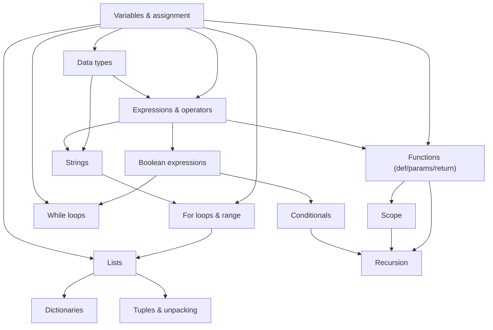

# Project 1 — Adaptive Learning System using LLM Agent

## 1. Selected domain
## 2. Why we selected it
## 3. Concepts

| Concept | Tutorial A | Tutorial B | Tutorial C | Coverage | Prerequisite | Dependency evidence | Assessment evidence | Adaptive relevance |
| :---- | :---: | :---: | :---: | :---: | :---- | :---- | :---- | :---: |
| Variables & assignment | ✓ | ✓ | ✓ | 3/3 | — (root) | Không phụ thuộc concept khác, cả 3 nguồn đều dạy đầu tiên | Variable-state tracking / Code tracing | ✓ |
| Data types (int, float, str, bool) | ✓ | ✓ | ✓ | 3/3 | Variables → Data types | Giá trị phải được gán vào biến trước khi phân biệt kiểu | Type-of-result prediction / Type conversion identification | ✓ |
| Expressions & operators | ✓ | ✓ | ✓ | 3/3 | Variables + Data types → Expressions | `width * height` cần biết giá trị và kiểu của biến | Expression evaluation | ✓ |
| Strings | ✓ | ✓ | ✓ | 3/3 | Data types + Expressions → Strings | Nối/lặp chuỗi (`'a'+'b'`, `'x'*3`) dùng cơ chế expression | Index/slice evaluation / String transformation tracing | ✓ |
| Boolean expressions | ✓ | ✓ | ✓ | 3/3 | Expressions → Boolean expressions | So sánh cần đánh giá hai expression trước (`x > y`) | Boolean-expression evaluation | ✓ |
| Conditionals | ✓ | ✓ | ✓ | 3/3 | Boolean expressions → Conditionals | `if` cần một boolean expression làm điều kiện | Branch tracing | ✓ |
| While loops | ✓ | ✓ | ✓ | 3/3 | Boolean expressions + Variables → While | Điều kiện dừng vòng lặp là boolean expression trên biến | Loop termination / infinite-loop detection | ✓ |
| For loops & range | ✓ | ✓ | ✓ | 3/3 | Variables + Strings → For | Cần một sequence (string/list) để duyệt qua | Loop tracing / off-by-one detection | ✓ |
| Lists | ✓ | ✓ | ✗ | 2/3 | Variables + For loops → Lists | List thường được xây dựng/duyệt qua vòng lặp trong ví dụ | Index/slice evaluation / Collection state tracking | ✓ |
| Dictionaries | ✓ | ✓ | ✗ | 2/3 | Lists + Variables → Dictionaries | Dict dùng cùng cơ chế lookup như list nhưng với key | Dictionary lookup tracing | ✓ |
| Tuples & unpacking | ✓ | ✓ | ✗ | 2/3 | Lists + Variables → Tuples | Unpacking (`a,b = b,a`) cần Multiple assignment đã học ở Variables | Unpacking syntax tracing | ~ |
| Functions (def, params, return) | ✓ | ✓ | ✓ | 3/3 | Variables + Expressions → Functions | Tham số/return value là biến và expression trong một phạm vi mới | Code tracing (call flow) / return vs print | ✓ |
| Scope | ✓ | ✓ | ✗ | 2/3 | Functions → Scope | Khái niệm local/global chỉ có ý nghĩa khi đã có function | Scope tracing / NameError identification | ✓ |
| Recursion | ~ | ~ | ✗ | 1.5/3 | Functions + Scope + Conditionals → Recursion | Hàm tự gọi cần base case (Conditionals) để dừng | Recursive tracing / base-case identification | ✓ |
| Exceptions | ✓ | ✓ | ✗ | 2/3 | Functions + Conditionals → Exceptions | `try/except` bọc quanh code có thể lỗi, cần luồng điều khiển đã học | Exception-handling flow tracing | ~ |
| File I/O | ✓ | ✓ | ✗ | 2/3 | Strings + Exceptions → File I/O | Đọc/ghi file trả về string, cần xử lý lỗi khi file không tồn tại | Output prediction / data-persistence tracing | ~ |
| Classes & objects | ✓ | ✓ | ✗ | 2/3 | Functions + Scope → Classes | Method là function gắn với object, `self` cần hiểu scope | Object-state tracking | ~ |

## 4. Prerequisite graph

## 5. Initial question-bank design

The question bank is maintained as a fixed set of questions
with predefined metadata for reproducible experiments.

Each question contains:

- question_id
- concept
- prerequisite_concepts
- question
- option A
- option B
- option C
- option D
- difficulty
- correct_answer
- common_error_type
- option_error_mapping
- explanation

See the full question bank: https://docs.google.com/spreadsheets/d/1QeZse76DHPPyifIvc3B6-VDqI8c-I_2QwgYS_byWG6Y/edit?gid=0#gid=0

## 6. Student-state representation
## 7. Things we still don't know
## 8. Questions for discussion