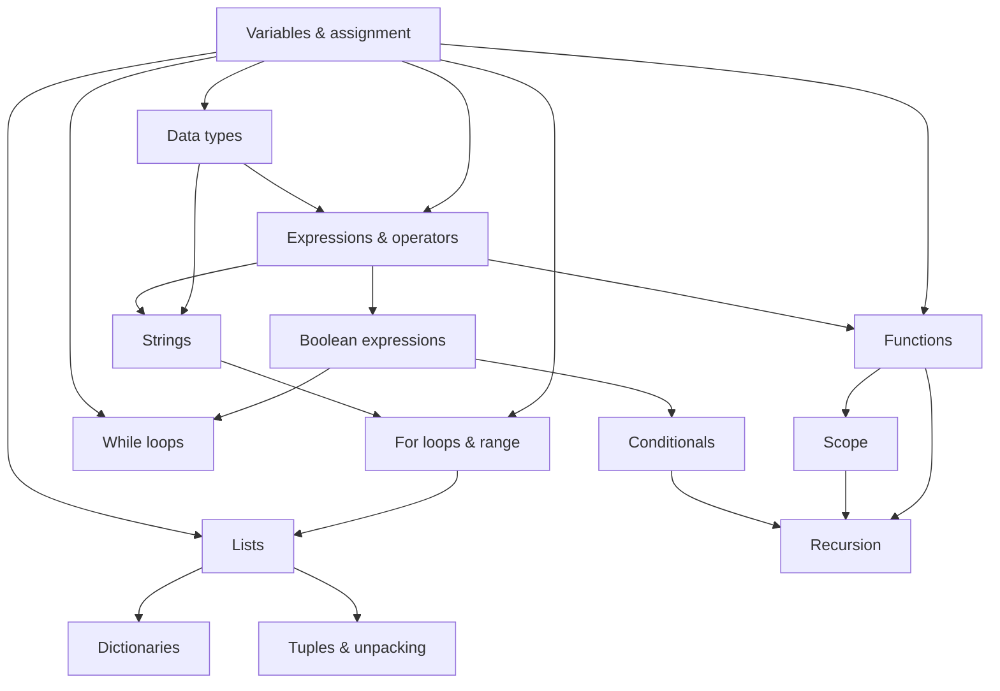

# Project 1 — Adaptive Learning System using LLM Agent

**Báo cáo tiến độ** · 20/10/2026
Mã nguồn: https://github.com/nguyenTraMy-dasick/adaptive-learning-llm-agent

---

## 0. Tóm tắt

**Thesis:** This project investigates whether an LLM agent can improve adaptive
learning by making sequential pedagogical decisions based on an explicit model of a learner's
evolving knowledge state.

**Research question chính:** Given the same learner state and available pedagogical actions, can an
LLM-based policy outperform random and rule-based adaptive strategies in selecting the next
instructional action?

**Research question phụ:** Does the resulting policy lead to higher learning gains or faster mastery?

Giữ cố định **domain, question bank, student model và action space**, chỉ thay đổi
**policy ra quyết định** (Random, Rule-based, LLM Agent).

| Phase (project_0) | Trạng thái |
| :--- | :--- |
| 1. Define the learning domain | Xong: Python nhập môn, 14 concept, prerequisite graph 21 cạnh |
| 2. Build question bank | Xong: 70 câu trắc nghiệm, đã kiểm tra tự động bằng cách chạy code |
| 3. Simplest student model | Xong: exponential update (EMA) |
| 4. Baseline policies | Xong: Random, Rule-based, LLM Agent (code xong, **chưa chạy với LLM thật**) |
| 5. Evaluate agent decisions | Có quy trình, bộ scenario và rubric; **chưa có nhãn expert** |
| 6. Evaluate learning effectiveness | Chưa có thí nghiệm người thật; đã có thí nghiệm trên learner mô phỏng |

---

## 1. Phase 1 — Learning domain

### 1.1. Domain đã chọn

**Lập trình Python nhập môn**, từ biến và kiểu dữ liệu đến hàm, phạm vi biến và đệ quy (14 concept).

### 1.2. Lý do chọn

- **Cấu trúc tiên quyết rõ ràng:** các concept phụ thuộc nhau tự nhiên (không hiểu function thì
  không hiểu recursion), đúng nhu cầu của project là phân biệt learner yếu ở concept trực tiếp
  hay ở tiên quyết.
- **Đánh giá được tự động và khách quan:** phần lớn câu hỏi là dự đoán output của một đoạn code,
  nên đáp án kiểm chứng được bằng cách chạy code.
- **Lỗi sai có tính hệ thống:** các misconception phổ biến (off-by-one, nhầm `print` với `return`,
  aliasing list...) được ghi nhận nhiều, thuận lợi cho việc gắn mỗi phương án sai với một loại lỗi.
- **Có nguồn giáo trình chuẩn để đối chiếu**, và là domain nhóm nắm vững.

### 1.3. Khảo sát concept

Khảo sát 3 nguồn: **A** = Python Tutorial (docs.python.org/3/tutorial),
**B** = CS50P (Harvard), **C** = Coursera "Programming for Everybody (Getting Started with Python)".
Ký hiệu: ✓ có dạy, ~ dạy một phần, ✗ không dạy.

| Concept | A | B | C | Coverage | Prerequisite trực tiếp | Dependency evidence | Assessment evidence | Adaptive relevance |
| :---- | :---: | :---: | :---: | :---: | :---- | :---- | :---- | :---: |
| Variables & assignment | ✓ | ✓ | ✓ | 3/3 | — (root) | Không phụ thuộc concept khác, cả 3 nguồn đều dạy đầu tiên | Variable-state tracking / Code tracing | ✓ |
| Data types (int, float, str, bool) | ✓ | ✓ | ✓ | 3/3 | Variables | Giá trị phải được gán vào biến trước khi phân biệt kiểu | Type-of-result prediction / Type conversion | ✓ |
| Expressions & operators | ✓ | ✓ | ✓ | 3/3 | Variables, Data types | `width * height` cần biết giá trị và kiểu của biến | Expression evaluation | ✓ |
| Strings | ✓ | ✓ | ✓ | 3/3 | Data types, Expressions | Nối/lặp chuỗi (`'a'+'b'`, `'x'*3`) dùng cơ chế expression | Index/slice evaluation | ✓ |
| Boolean expressions | ✓ | ✓ | ✓ | 3/3 | Expressions | So sánh cần đánh giá hai expression trước (`x > y`) | Boolean-expression evaluation | ✓ |
| Conditionals | ✓ | ✓ | ✓ | 3/3 | Boolean expressions | `if` cần một boolean expression làm điều kiện | Branch tracing | ✓ |
| While loops | ✓ | ✓ | ✓ | 3/3 | Variables, Boolean expressions | Điều kiện dừng là boolean expression trên biến | Loop termination / infinite-loop detection | ✓ |
| For loops & range | ✓ | ✓ | ✓ | 3/3 | Variables, Strings | Cần một sequence (string/list) để duyệt qua | Loop tracing / off-by-one detection | ✓ |
| Lists | ✓ | ✓ | ✗ | 2/3 | Variables, For loops | List thường được xây dựng/duyệt bằng vòng lặp | Index/slice evaluation / state tracking | ✓ |
| Dictionaries | ✓ | ✓ | ✗ | 2/3 | Lists | Dict dùng cơ chế lookup như list nhưng theo key | Dictionary lookup tracing | ✓ |
| Tuples & unpacking | ✓ | ✓ | ✗ | 2/3 | Lists | Unpacking (`a, b = b, a`) dựa trên multiple assignment | Unpacking tracing | ~ |
| Functions (def, params, return) | ✓ | ✓ | ✓ | 3/3 | Variables, Expressions | Tham số/giá trị trả về là biến và expression trong phạm vi mới | Call-flow tracing / return vs print | ✓ |
| Scope | ✓ | ✓ | ✗ | 2/3 | Functions | Local/global chỉ có nghĩa khi đã có function | Scope tracing / NameError identification | ✓ |
| Recursion | ~ | ~ | ✗ | 1.5/3 | Functions, Scope, Conditionals | Hàm tự gọi cần base case (Conditionals) để dừng | Recursive tracing / base-case identification | ✓ |
| *Exceptions* | ✓ | ✓ | ✗ | 2/3 | Functions, Conditionals | `try/except` bọc quanh code có thể lỗi | Exception-flow tracing | ~ |
| *File I/O* | ✓ | ✓ | ✗ | 2/3 | Strings, Exceptions | Đọc/ghi file trả về string, cần xử lý lỗi | Output prediction | ~ |
| *Classes & objects* | ✓ | ✓ | ✗ | 2/3 | Functions, Scope | Method là function gắn với object | Object-state tracking | ~ |

**14 concept đầu được đưa vào hệ thống.** Ba concept cuối (in nghiêng) được khảo sát nhưng loại
khỏi phạm vi để giữ domain nhỏ: chúng có adaptive relevance thấp (~) và khó đánh giá bằng câu
trắc nghiệm dự đoán output ngắn.

### 1.4. Prerequisite graph

14 concept, 21 cạnh có hướng, là đồ thị không chu trình (DAG) với gốc là *Variables & assignment*.
Graph được lưu ở `data/concept_graph.json` và được code kiểm tra tự động (đúng DAG, cạnh hai chiều
nhất quán).



---

## 2. Phase 2 — Question bank

### 2.1. Metadata

Dùng **fixed question bank** (không sinh câu bằng LLM) để thí nghiệm tái lập được. Ngoài metadata tối thiểu project_0 đề xuất, project hiện tại thêm 4 phương án và ánh xạ
từng phương án sai với một loại lỗi.

| Trường | Ý nghĩa |
| :--- | :--- |
| `question_id` | Mã câu, ví dụ `REC_003` |
| `concept` | Concept chính mà câu đánh giá |
| `prerequisite_concept` | Concept tiên quyết liên quan (một hoặc nhiều, cách nhau bởi `;`) |
| `question`, `option_A`–`option_D` | Đề và 4 phương án |
| `difficulty` | Easy / Medium / Hard |
| `correct_answer` | Đáp án đúng (A–D) |
| `common_error_type` | Misconception chính mà câu nhắm tới |
| `option_error_mapping` | *Bổ sung:* mỗi phương án sai tương ứng với lỗi nào |
| `explanation` | Giải thích đáp án |

### 2.2. Quy mô

- **70 câu = 14 concept × 5 câu** (mỗi concept: 2 Easy, 2 Medium, 1 Hard), 100% trắc nghiệm.
- Dạng câu chủ yếu là code tracing (dự đoán output, lỗi phát sinh, giá trị biến).
- Bản chính thức là `data/question_bank.csv` trong repo
  ([bản Google Sheet](https://docs.google.com/spreadsheets/d/1QeZse76DHPPyifIvc3B6-VDqI8c-I_2QwgYS_byWG6Y/edit?gid=0#gid=0)
  dùng khi soạn thảo).

### 2.3. Ví dụ (`REC_003`, Recursion, Medium)

```python
def f(n):
    if n <= 1:
        return 1
    return n * f(n - 1)

print(f(4))
```

| Phương án | Loại lỗi tương ứng |
| :--- | :--- |
| **A. 24** | Đáp án đúng |
| B. 10 | Cộng các giá trị (4 + 3 + 2 + 1) thay vì nhân |
| C. 12 | Dừng sau một tầng đệ quy (4 × 3) |
| D. 6 | Bỏ n hiện tại, chỉ trả về f(3) |

Prerequisite: Functions; Conditionals. Common error type: *Tracing recursive calls / combining return values.*

### 2.4. Kiểm soát chất lượng

Script `scripts/validate_question_bank.py` kiểm tra tự động: đủ cột, concept và prerequisite có
trong graph, **prerequisite của câu phải là tổ tiên của concept trong graph**, đáp án hợp lệ,
4 phương án không trùng nhau, và **đoạn code trong mỗi câu phải compile được**. Nhóm đã chạy thật
code của cả 70 câu để đối chiếu output với đáp án.

Lần rà soát này phát hiện và sửa: 1 câu sai đáp án, 4 câu code bị lỗi thụt lề, 1 câu có hai phương
án trùng, 7 câu có prerequisite mâu thuẫn với graph, 4 câu gắn nhầm concept (đã viết lại) và 5 câu
có ánh xạ lỗi không khớp phương án. Chi tiết ở `TEAM_MEMBER_1.md`.

---

## 3. Phase 3 — Student model

### 3.1. Công thức

Nhóm chọn **exponential update**:

```text
outcome     = 1 nếu đúng, 0 nếu sai
M_k (mới)   = M_k (cũ) + α · (outcome − M_k (cũ)),   α = 0.4,   M_k ban đầu = 0
```

Learner được coi là **thành thạo** concept khi `M_k ≥ 0.85`. Với α = 0.4, cần 4 câu đúng liên tiếp
(0.40 → 0.64 → 0.78 → 0.87). Ban đầu nhóm dùng α = 0.3, nhưng vì mỗi concept chỉ có 5 câu nên
mastery tối đa chỉ đạt 0.832 (`1 − 0.7⁵`), không bao giờ chạm ngưỡng 0.85.

Lý do chọn EMA thay vì BKT ở phiên bản đầu: đơn giản, hoàn toàn tất định, dễ giải thích cho Agent
và cho người đọc log. BKT là bước nâng cấp dự kiến.

### 3.2. Learner state

Learner state là **snapshot bất biến**, giống hệt nhau cho cả 3 policy:

| Trường | Nội dung | Ví dụ |
| :--- | :--- | :--- |
| `mastery` | Mastery 0–1 của từng concept đã gặp | `{"Functions": 0.45, "Recursion": 0.25, ...}` |
| `recent_errors` | Loại lỗi của các câu sai gần đây (tối đa 10) | `"Confusing print with return"` |
| `recent_actions` | Các action gần đây (tối đa 10) | `"ASK:REC_003:Recursion:wrong"`, `"EXPLAIN:Recursion"` |
| `attempted_question_ids` | Các câu đã làm (không hỏi lại) | `["FUN_001", "REC_003", ...]` |

Ngoài ra hệ thống theo dõi **bối cảnh phiên** (decision context): concept đang học, các concept đã
mở, action trước đó, kết quả câu gần nhất. Cả 3 policy cùng nhận bối cảnh này.

---

## 4. Phase 4 — Baseline policies

### 4.1. Kiến trúc và action space

Agent là **decision-maker**, không phải chatbot làm mọi việc. Mỗi lượt:

```text
Learner state + bối cảnh
   → sinh danh sách action hợp lệ (giống nhau cho mọi policy)
   → policy chọn MỘT action
   → Python kiểm tra action có trong danh sách (không có → từ chối, state giữ nguyên)
   → Python thực thi: chọn câu từ question bank cố định, chấm bằng answer key, cập nhật mastery
```

Action space gồm đúng 5 loại action như project_0:

| Action | Có trong danh sách khi |
| :--- | :--- |
| `ASK(concept, difficulty)` | Concept đang học còn câu chưa làm ở độ khó đó |
| `HINT(concept)` | Đã hỏi ít nhất một câu của concept đang học |
| `EXPLAIN(concept)` | Đã có concept đang học |
| `REVIEW_PREREQUISITE(p)` | `p` là tiên quyết trực tiếp của concept đang học |
| `ADVANCE(c)` | `c` là concept mới, mọi tiên quyết của `c` đã được học tới, `c` còn câu |

Danh sách **không** chặn theo ngưỡng mastery. Policy vẫn có thể chuyển concept quá sớm, và đó là
một lỗi sư phạm cần đo ở Phase 5.

### 4.2. Baseline A — Random

Chọn đều một action trong danh sách hợp lệ, có seed để tái lập. Không cá nhân hóa.

### 4.3. Baseline B — Rule-based adaptive

Mở rộng từ luật mẫu của project_0, thêm phần xử lý tiên quyết. Ký hiệu `m` = mastery của concept
đang học; "vừa sai" = action ngay trước là ASK trên concept đang học và trả lời sai.

| Luật | Điều kiện | Action |
| :--- | :--- | :--- |
| R0 | Đầu phiên | ADVANCE tới concept gốc |
| R1 | `m ≥ 0.85` | ADVANCE (ưu tiên concept phụ thuộc trực tiếp, chưa thành thạo) |
| R2 | Vừa sai, `m < 0.40`, có tiên quyết với mastery `< 0.60` | REVIEW_PREREQUISITE tiên quyết yếu nhất |
| R3 | Vừa sai, `m < 0.40` | EXPLAIN (không lặp lại hai lần liên tiếp) |
| R4 | Vừa sai, `0.40 ≤ m < 0.75` | HINT |
| R5 | Còn câu | ASK: `m < 0.40` → Easy, `0.40–0.75` → Medium, `≥ 0.75` → Hard |
| R6 | Concept đang học hết câu | ADVANCE, nếu không thì REVIEW / EXPLAIN |

So với luật mẫu trong project_0, nhóm giữ nguyên các ngưỡng 0.4 / 0.75 / 0.85 và thêm R2 (ôn tiên
quyết), R4 (gợi ý) và R6 (xử lý khi hết câu).

### 4.4. Policy C — LLM Agent

**Đầu vào** (ví dụ thật do hệ thống sinh, rút gọn phần graph):

```text
Learner mastery estimates (0 = not mastered, 1 = fully mastered):
- Functions: 0.45
- Scope: 0.80
- Recursion: 0.25
  ...
Session context:
- Focus concept: Recursion
- Previous action: ASK Recursion Medium
- Most recent question: REC_003 on Recursion -> wrong
Recent mistakes (oldest first):
- Confusing print with return
- Tracing recursive calls / combining return values
Recent actions (oldest first):
- ASK:FUN_003:Functions:wrong
- ASK:REC_001:Recursion:correct
- ASK:REC_003:Recursion:wrong
Available actions (choose exactly one by its number):
0. ASK concept=Recursion difficulty=Easy
  ...
4. EXPLAIN concept=Recursion
5. REVIEW_PREREQUISITE concept=Functions
  ...
9. ADVANCE concept=While loops
```

**Đầu ra** có cấu trúc: `{"action_index": 5, "rationale": "..."}`. Khác với ví dụ trong project_0
(LLM tự ghi tên concept và độ khó), nhóm cho LLM **chọn theo số thứ tự**, nên LLM không thể đưa ra
concept hay độ khó ngoài danh sách.

**Ràng buộc:**
- Prompt **không** chứa nội dung câu hỏi, đáp án, hay các ngưỡng của rule-based (để LLM tự ra
  quyết định, không bắt chước luật).
- Trả lời sai định dạng thì hỏi lại tối đa 2 lần; vẫn sai thì lượt đó được ghi là invalid. Tỉ lệ
  invalid là một chỉ số được báo cáo.
- Rationale của LLM chỉ để phân tích, không dùng làm bằng chứng action hợp lệ.
- Lưu toàn bộ prompt và output thô để phân tích lỗi.

### 4.5. Tính công bằng giữa các policy

Ở mỗi bước, cả 3 policy nhận **cùng learner state, cùng bối cảnh và cùng danh sách action**. Question
bank, student model và cách thực thi action là một, chỉ thuật toán chọn action khác nhau.

---

## 5. Phase 5 — Đánh giá quyết định của Agent

### 5.1. Thiết kế

Theo gợi ý của project_0: tạo một bộ **learner state mô phỏng**, nhờ expert gán nhãn action nên
chọn, rồi so quyết định của từng policy với nhãn. Hiện có **12 scenario**, phủ các tình huống:
bắt đầu phiên; concept mới chưa có dữ liệu; concept yếu do tiên quyết yếu; concept yếu khi tiên
quyết vững; mastery trung bình vừa sai; mastery khá vừa đúng; đã thành thạo; sai lặp cùng kiểu
lỗi; hết câu hỏi; vừa giải thích xong; đúng liên tiếp nhưng mastery còn thấp; quay lại sau khi ôn
tiên quyết.

### 5.2. Tiêu chí

Các câu hỏi đánh giá trong project_0 được chuyển thành tiêu chí chấm (0 = sai, 1 = chấp nhận được,
2 = tốt):

| Câu hỏi trong project_0 | Tiêu chí |
| :--- | :--- |
| Was remediation needed? | `remediation` |
| Did it select the correct weak concept? | `weak_concept` |
| Was difficulty appropriate? | `difficulty` |
| Should it explain or ask another question? | `support_vs_ask` |
| Did it advance too early? | `advance_timing` |
| Did it give away the answer? | `no_giveaway` |

Mỗi annotator ghi **action nên chọn** (preferred) và **action chấp nhận được** (acceptable).
Chỉ số chính: tỉ lệ quyết định trùng preferred (exact agreement) và trùng preferred hoặc acceptable
(acceptable agreement). Random được chạy với nhiều seed để làm mức nền.

### 5.3. Trạng thái

- Bộ scenario, rubric và script đánh giá đã xong (`evaluation/`).
- **Chưa có nhãn expert.** Nhóm cố ý chưa gán, vì người viết luật cho rule-based không nên tự gán
  nhãn (rule-based sẽ được lợi giả tạo), và người gán không nên thấy quyết định của LLM trước.
- Hiện chỉ có phân bố loại action (chưa có agreement): Random chọn ADVANCE 38%, ASK 22%,
  REVIEW 20%, EXPLAIN 13%, HINT 7% và chuyển concept quá sớm ở 15% lượt; Rule-based chọn ASK 33%,
  ADVANCE 25%, HINT 25%, EXPLAIN 8%, REVIEW 8%.

---

## 6. Phase 6 — Đánh giá hiệu quả học

### 6.1. Thí nghiệm với người học thật

Chưa thực hiện. Theo project_0, nếu không làm được thí nghiệm pre-test / post-test với người thật,
claim của project sẽ giới hạn ở **"LLM Agent produces more appropriate adaptive instructional
decisions"**, không khẳng định "LLM Agent improves learning".

### 6.2. Thí nghiệm trên learner mô phỏng

Để kiểm tra toàn bộ vòng lặp và có số liệu sơ bộ, nhóm xây **learner mô phỏng**:

- Mỗi learner có "kiến thức thật" cho từng concept; **policy không nhìn thấy**, chỉ thấy mastery do
  student model ước lượng.
- Xác suất trả lời đúng = 0.25 (đoán) + 0.65 × kiến thức hiệu dụng. Kiến thức hiệu dụng giảm khi
  tiên quyết yếu, và giảm với câu khó.
- Mỗi action làm kiến thức tăng theo một hệ số riêng (làm câu kèm giải thích, EXPLAIN, HINT, ôn
  tiên quyết); tiên quyết yếu làm việc học chậm lại.
- 6 hồ sơ learner: mới bắt đầu, đã vững phần cơ bản, hổng Functions/Scope, học nhanh, học chậm,
  gần thành thạo.
- Pre/post-test = điểm kỳ vọng trên toàn bộ 70 câu, tính từ kiến thức thật.

Chỉ số theo project_0: `LearningGain = PostTest − PreTest`, `Efficiency = LearningGain / #Questions`,
thêm normalized gain và số lượt tới thành thạo.

### 6.3. Kết quả sơ bộ (6 learner × 10 seed, 60 lượt mỗi phiên)

| Policy | Learning gain | Normalized gain | Số câu đã hỏi | Concept đạt 0.85 (TB) |
| :--- | :---: | :---: | :---: | :---: |
| Random | 0.064 ± 0.031 | 0.108 ± 0.041 | 14.8 | 0.4 |
| Rule-based | 0.100 ± 0.050 | 0.168 ± 0.063 | 31.9 | 0.9 |
| LLM Agent | *chưa chạy* | | | |

Rule-based cao hơn Random ở cả 6 hồ sơ learner. Tuy vậy, đây chỉ là **bằng chứng trên mô phỏng**:
kết quả phụ thuộc giả định của simulator, và chưa có kiểm định thống kê.

---

## 7. Trạng thái triển khai

- Code Python thuần (không cần thư viện ngoài), 120 test tự động, gồm cả test tích hợp toàn bộ
  vòng lặp.
- Mọi thí nghiệm tái lập được (seed cố định) và ghi log từng lượt.
- Hướng dẫn chạy ở `README.md`; phân công và quyết định của nhóm ở `TEAM_TASKS.md`.

---

## 8. Những điều nhóm chưa biết và câu hỏi xin ý kiến

### 8.1. Quyết định nhóm đã tự chốt

| Quyết định | Lý do |
| :--- | :--- |
| Giữ 14 concept, loại Exceptions, File I/O, Classes | Giữ domain nhỏ; ba concept này khó đánh giá bằng câu dự đoán output ngắn |
| Student model EMA với α = 0.4 | α = 0.3 làm ngưỡng 0.85 không thể đạt với 5 câu/concept |
| LLM chọn action theo số thứ tự | Loại bỏ khả năng LLM đưa ra action không tồn tại |
| Không đưa ngưỡng của rule-based vào prompt LLM | Để LLM tự quyết định, so sánh có ý nghĩa |
| Khi LLM lỗi định dạng: ghi invalid, không thay bằng rule-based | Kết quả của LLM không bị lẫn quyết định của rule-based |
| Action space không chặn ADVANCE theo mastery | Để đo được lỗi chuyển concept quá sớm |

### 8.2. Việc nhóm sẽ tự quyết trước khi chạy LLM

1. **Gán nhãn Phase 5 trước, chạy LLM sau.** Mở rộng lên 30–50 scenario; ít nhất 2 người gán độc lập;
   chốt trước chỉ số chính.
2. **Đóng băng prompt:** chỉnh prompt trên một bộ scenario riêng, không chỉnh trên bộ dùng để đánh giá.
3. **Đóng băng tham số learner mô phỏng** và lên trước kế hoạch phân tích độ nhạy (đổi hệ số học).
4. **Lặp lại nhiều lần với LLM:** chạy mỗi scenario 3–5 lần để đo độ ổn định, vì LLM có thể trả lời
   khác nhau giữa các lần chạy.
5. **Kiểm định thống kê:** so sánh ghép cặp theo (learner, seed), ví dụ kiểm định Wilcoxon.
6. **Ước lượng chi phí:** Phase 6 với cấu hình hiện tại cần khoảng 3.600 lần gọi API cho mỗi lượt chạy.

### 8.3. Câu hỏi xin ý kiến

1. **Phạm vi claim.** Nếu nhóm chỉ làm Phase 5 (đánh giá quyết định) và Phase 6 trên learner mô
   phỏng, như vậy có đủ cho đồ án không, hay nhóm nên cố gắng làm một thí nghiệm nhỏ với người thật
   (ví dụ 15–30 sinh viên, pre/post-test)?
2. **Expert annotation.** Ai được coi là "expert" để gán nhãn? Mentor hoặc trợ giảng có thể tham gia
   không? Bao nhiêu scenario và bao nhiêu annotator là đủ?
3. **Student model.** EMA có đủ cho đồ án không, hay nhóm nên chuyển sang BKT trước khi chạy LLM?
   Có cần validate student model trên ASSISTments/EdNet như project_0 gợi ý không, khi domain của
   nhóm là Python?
4. **Question bank.** 5 câu/concept khiến learner yếu dùng hết câu trước khi thành thạo. Nên bổ sung
   lên khoảng 8–10 câu/concept, hay chấp nhận giới hạn này và nêu trong báo cáo?
5. **Độ mạnh của baseline.** Rule-based hiện dùng ngưỡng lấy từ project_0, chưa tinh chỉnh. Có cần
   tinh chỉnh để baseline mạnh nhất có thể không (so sánh với LLM sẽ công bằng hơn)?
6. **Thông tin cho LLM.** Có nên cung cấp thêm kiến thức sư phạm trong prompt (ví dụ nguyên tắc
   mastery learning, scaffolding) hay giữ prompt trung lập như hiện tại?
7. **Chọn LLM.** Nên dùng một model hay so sánh nhiều model (ví dụ một model lớn và một model nhỏ)?
8. **Learner mô phỏng.** Kết quả trên learner mô phỏng có được chấp nhận làm bằng chứng phụ không? Có góp ý gì về các giả định của simulator (mục 6.2)?
